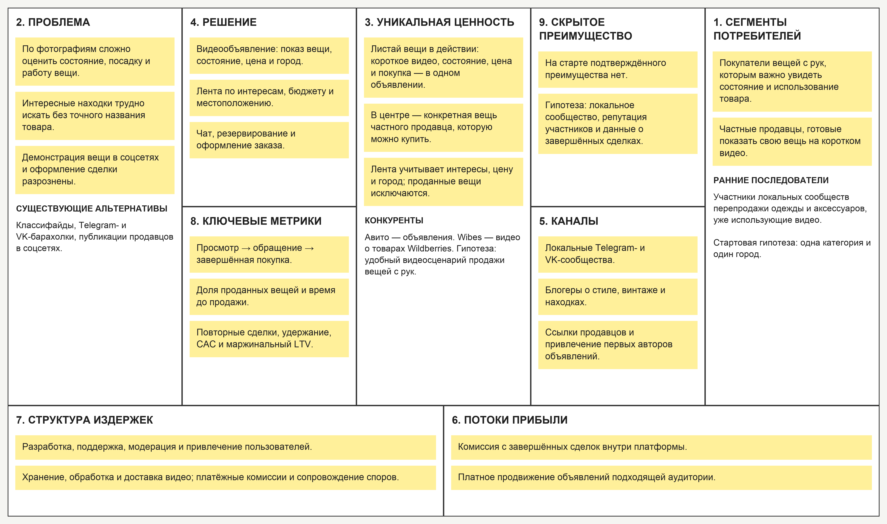
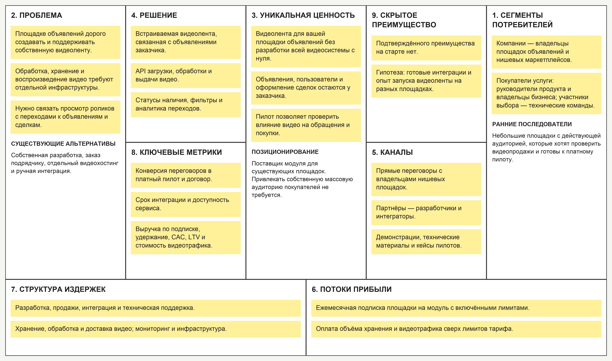

# Листай — видеомаркетплейс вещей

Проект по курсу «Методы управления разработкой ПО» VK Education.

**Бизнес-модель:** C2C (Consumer-to-Consumer).

## ДЗ №1. Lean Canvas и Elevator Pitch

### О проекте

Площадка, где люди продают личные вещи через короткие вертикальные видео. Покупатель листает объявления с учётом интересов, бюджета и города, смотрит вещь в использовании, общается с продавцом и оформляет заказ. Видео дополняется фотографиями, описанием состояния и ценой.

Регистрация, просмотр и базовая публикация бесплатны. Сервис зарабатывает на комиссии с завершённых сделок и платном продвижении объявлений. Для первоначальной проверки спроса предполагается запуск в одной категории — одежда и аксессуары — в одном городе.

### Elevator Pitch

При покупке вещей с рук по фотографиям бывает сложно оценить их состояние и понять, как они выглядят или работают в жизни. Мы создаём видеомаркетплейс, где люди продают свои вещи через короткие ролики, а покупатели листают ленту с учётом интересов, бюджета и города. Продавец показывает конкретную вещь в использовании, а покупатель может сразу увидеть цену, написать автору и оформить заказ. Каждый ролик связан с актуальным объявлением и возможностью покупки. Сервис зарабатывает на комиссии с завершённых сделок и платном продвижении объявлений.

### Lean Canvas

## ДЗ №2. HADI, юнит-экономика и Pivot

Все числа — учебные допущения. Эксперименты ещё не проведены.

### 1. HADI-гипотеза

**Критичный риск — ценность:** будут ли продавцы снимать видео, а покупатели — покупать через ленту?

- **H — гипотеза:** видео помогает оценить вещь и вызывает интерес к покупке, а продавцы готовы публиковать такие объявления.
- **A — действие:** провести двухнедельный пилот одежды и аксессуаров в одном городе. Пригласить 20 продавцов и привлечь 200 потенциальных покупателей в тестовую ленту с ценами, чатом и оформлением заказа.
- **D — данные:** доля продавцов, самостоятельно опубликовавших ролик; доля посетителей, обратившихся к продавцу; доля посетителей с завершённой покупкой после получения вещи.
- **I — выводы:** если не менее 12 продавцов опубликуют ролик, 20 посетителей обратятся и 10 завершат покупку, продолжить пилот и проверить повторные сделки. Если пороги не достигнуты — разобрать причины отказов и повторить проверку после изменений. При устойчиво слабом спросе или недостаточной марже проверить план Б.

### 2. Юнит-экономика C2C

**Юнит — покупатель с первой завершённой сделкой.** Доход от продвижения пока не учитываем.

#### CAC

Стоимость клика — 25 ₽, конверсия в регистрацию — 25%, из регистрации в первую покупку — 20%. На привлечение продавцов дополнительно закладываем 100 ₽ в пересчёте на покупателя.

**CAC = 25 / (0,25 × 0,20) + 100 = 600 ₽.**

#### LTV

| Допущение на одну завершённую сделку | Сумма |
| --- | ---: |
| Средняя стоимость вещи | 3 000 ₽ |
| Доход площадки — комиссия 10% | 300 ₽ |
| Обработка платежа — условно 3% от стоимости вещи | 90 ₽ |
| Видеоинфраструктура | 20 ₽ |
| Поддержка и модерация | 30 ₽ |
| Расходы на отмены и споры в пересчёте на завершённую сделку | 20 ₽ |

**Маржа = 300 − 90 − 20 − 30 − 20 = 140 ₽.**

При 6 покупках за время использования: **LTV = 140 × 6 = 840 ₽.**

**LTV / CAC = 840 / 600 = 1,4.** После привлечения остаётся 240 ₽ на покрытие постоянных расходов. При 3 покупках LTV падает до 420 ₽ и не покрывает CAC.

**Вывод:** модель зависит от повторных покупок и пока имеет небольшой запас маржи. Проверяем удержание, стоимость привлечения и доход от продвижения; ориентир для дальнейшей проверки — LTV / CAC не ниже 3. Расходы на видео распределяются с учётом просмотров и объявлений без продаж; постоянная разработка и команда в расчёт не включены.

### 3. План Б — Pivot

**Zoom-in Pivot и переход C2C → B2B:** вместо собственного маркетплейса продавать модуль видеоленты существующим площадкам объявлений.

Заказчик подключает ленту к своему каталогу через API. «Листай» обеспечивает загрузку и обработку роликов, выдачу видео, актуальность объявлений и аналитику переходов. У заказчика уже есть покупатели и продавцы, поэтому нам не нужно самостоятельно набирать массовую аудиторию. Первые потенциальные клиенты — небольшие нишевые площадки; сотрудничество с ними пока не подтверждено.

Монетизация — ежемесячная подписка с лимитами хранения и трафика, а также оплата превышения лимитов. Продажа компании крупной площадке может быть отдельным вариантом выхода, но сам пивот — изменение продукта и покупателей.

#### Проверка пивота

Провести переговоры с 15 подходящими площадками и предложить платный пилот. Предварительные критерии: минимум 3 площадки оплачивают пилот и минимум 2 из них продолжают использование по полной цене. Измерить сроки интеграции, расходы на видео и влияние на обращения покупателей. Длительность удержания проверяется отдельно.

#### Юнит-экономика B2B

**Юнит — платящая площадка.**

| Допущение | Значение |
| --- | ---: |
| Затраты на продажи, пилоты и первичное подключение 5 клиентов, включая неуспешные переговоры | 300 000 ₽ |
| Подписка | 30 000 ₽/мес. |
| Переменные расходы на видео, инфраструктуру и обслуживание клиента | 12 000 ₽/мес. |
| Средний срок платного использования | 12 месяцев |

**CAC = 300 000 / 5 = 60 000 ₽.**

**LTV = (30 000 − 12 000) × 12 = 216 000 ₽.**

**LTV / CAC = 216 000 / 60 000 = 3,6.** Возврат CAC — в течение четвёртого оплаченного месяца: 60 000 / 18 000 ≈ 3,33 месяца.

**Вывод:** при этих допущениях остаётся 156 000 ₽ на клиента после привлечения, до покрытия постоянных расходов. При удержании всего 3 месяца LTV равен 54 000 ₽ и не покрывает CAC. Поэтому цену, стоимость обслуживания и длительность договоров нужно проверить; расчёт сам по себе не подтверждает прибыльность.

### 4. Обновлённый Elevator Pitch

Площадкам объявлений дорого разрабатывать собственную видеоленту и поддерживать обработку и доставку роликов. «Листай» предлагает готовый модуль: продавцы показывают вещи на видео, покупатели листают объявления, а каталог и оформление сделок остаются на стороне площадки. Подключение через API позволяет проверить видеопродажи без разработки всей видеосистемы с нуля. Мы зарабатываем на подписке площадок и оплате использования сверх лимитов тарифа.

### 5. Обновлённый Lean Canvas

