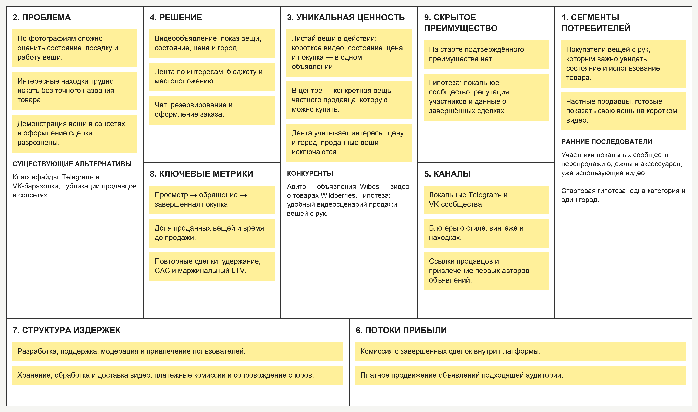
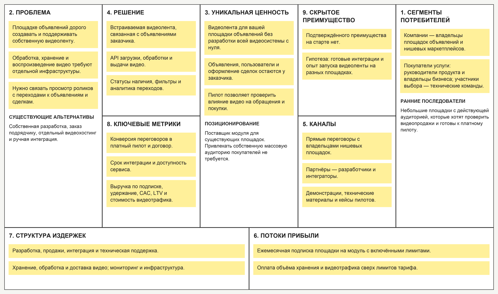
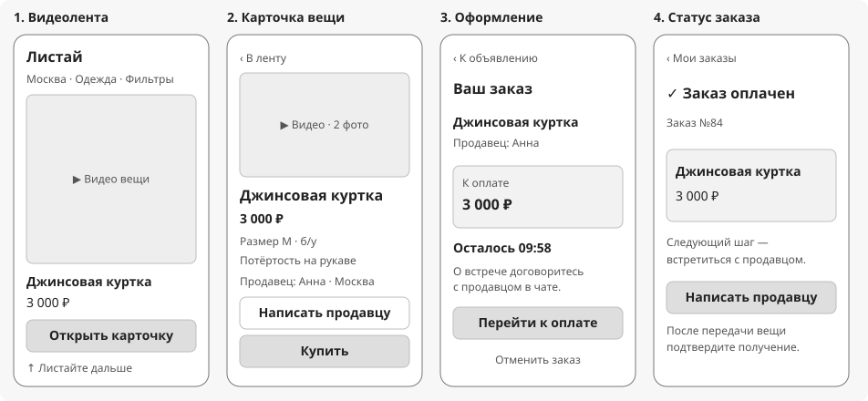
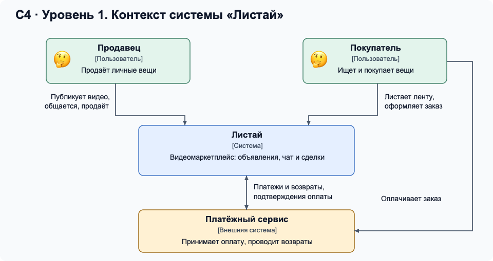
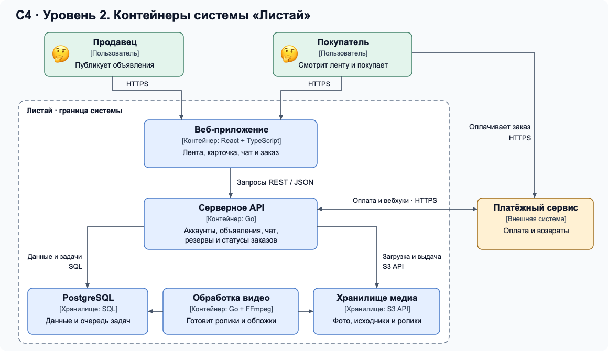

# Листай — видеомаркетплейс вещей

Проект по курсу «Методы управления разработкой ПО» VK Education.

**Бизнес-модель:** C2C (Consumer-to-Consumer).

## ДЗ №1. Lean Canvas и Elevator Pitch

### О проекте

Площадка, где люди продают личные вещи через короткие вертикальные видео. Покупатель листает объявления с учётом интересов, бюджета и города, смотрит вещь в использовании, общается с продавцом и оформляет заказ. Видео дополняется фотографиями, описанием состояния и ценой.

Регистрация, просмотр и базовая публикация бесплатны. Сервис зарабатывает на комиссии с завершённых сделок и платном продвижении объявлений. Для первоначальной проверки спроса предполагается запуск в одной категории — одежда и аксессуары — в одном городе.

### Elevator Pitch

При покупке вещей с рук по фотографиям бывает сложно оценить их состояние и понять, как они выглядят или работают в жизни. Мы создаём видеомаркетплейс, где люди продают свои вещи через короткие ролики, а покупатели листают ленту с учётом интересов, бюджета и города. Продавец показывает конкретную вещь в использовании, а покупатель может сразу увидеть цену, написать автору и оформить заказ. Каждый ролик связан с актуальным объявлением и возможностью покупки. Сервис зарабатывает на комиссии с завершённых сделок и платном продвижении объявлений.

### Lean Canvas



## ДЗ №2. HADI, юнит-экономика и Pivot

Все числа — учебные допущения. Эксперименты ещё не проведены.

### 1. HADI-гипотеза

**Критичный риск — ценность:** будут ли продавцы снимать видео, а покупатели — покупать через ленту?

- **H — гипотеза:** видео помогает оценить вещь и вызывает интерес к покупке, а продавцы готовы публиковать такие объявления.
- **A — действие:** провести двухнедельный пилот одежды и аксессуаров в одном городе. Пригласить 20 продавцов и привлечь 200 потенциальных покупателей в тестовую ленту с ценами, чатом и оформлением заказа.
- **D — данные:** доля продавцов, самостоятельно опубликовавших ролик; доля посетителей, обратившихся к продавцу; доля посетителей с завершённой покупкой после получения вещи.
- **I — выводы:** если не менее 12 продавцов опубликуют ролик, 20 посетителей обратятся и 10 завершат покупку, продолжить пилот и проверить повторные сделки. Если пороги не достигнуты — разобрать причины отказов и повторить проверку после изменений. При устойчиво слабом спросе или недостаточной марже проверить план Б.

### 2. Юнит-экономика C2C

**Юнит — покупатель с первой завершённой сделкой.** Доход от продвижения пока не учитываем.

#### CAC

Стоимость клика — 25 ₽, конверсия в регистрацию — 25%, из регистрации в первую покупку — 20%. На привлечение продавцов дополнительно закладываем 100 ₽ в пересчёте на покупателя.

**CAC = 25 / (0,25 × 0,20) + 100 = 600 ₽.**

#### LTV

| Допущение на одну завершённую сделку | Сумма |
| --- | ---: |
| Средняя стоимость вещи | 3 000 ₽ |
| Доход площадки — комиссия 10% | 300 ₽ |
| Обработка платежа — условно 3% от стоимости вещи | 90 ₽ |
| Видеоинфраструктура | 20 ₽ |
| Поддержка и модерация | 30 ₽ |
| Расходы на отмены и споры в пересчёте на завершённую сделку | 20 ₽ |

**Маржа = 300 − 90 − 20 − 30 − 20 = 140 ₽.**

При 6 покупках за время использования: **LTV = 140 × 6 = 840 ₽.**

**LTV / CAC = 840 / 600 = 1,4.** После привлечения остаётся 240 ₽ на покрытие постоянных расходов. При 3 покупках LTV падает до 420 ₽ и не покрывает CAC.

**Вывод:** модель зависит от повторных покупок и пока имеет небольшой запас маржи. Проверяем удержание, стоимость привлечения и доход от продвижения; ориентир для дальнейшей проверки — LTV / CAC не ниже 3. Расходы на видео распределяются с учётом просмотров и объявлений без продаж; постоянная разработка и команда в расчёт не включены.

### 3. План Б — Pivot

**Zoom-in Pivot и переход C2C → B2B:** вместо собственного маркетплейса продавать модуль видеоленты существующим площадкам объявлений.

Заказчик подключает ленту к своему каталогу через API. «Листай» обеспечивает загрузку и обработку роликов, выдачу видео, актуальность объявлений и аналитику переходов. У заказчика уже есть покупатели и продавцы, поэтому нам не нужно самостоятельно набирать массовую аудиторию. Первые потенциальные клиенты — небольшие нишевые площадки; сотрудничество с ними пока не подтверждено.

Монетизация — ежемесячная подписка с лимитами хранения и трафика, а также оплата превышения лимитов. Продажа компании крупной площадке может быть отдельным вариантом выхода, но сам пивот — изменение продукта и покупателей.

#### Проверка пивота

Провести переговоры с 15 подходящими площадками и предложить платный пилот. Предварительные критерии: минимум 3 площадки оплачивают пилот и минимум 2 из них продолжают использование по полной цене. Измерить сроки интеграции, расходы на видео и влияние на обращения покупателей. Длительность удержания проверяется отдельно.

#### Юнит-экономика B2B

**Юнит — платящая площадка.**

| Допущение | Значение |
| --- | ---: |
| Затраты на продажи, пилоты и первичное подключение 5 клиентов, включая неуспешные переговоры | 300 000 ₽ |
| Подписка | 30 000 ₽/мес. |
| Переменные расходы на видео, инфраструктуру и обслуживание клиента | 12 000 ₽/мес. |
| Средний срок платного использования | 12 месяцев |

**CAC = 300 000 / 5 = 60 000 ₽.**

**LTV = (30 000 − 12 000) × 12 = 216 000 ₽.**

**LTV / CAC = 216 000 / 60 000 = 3,6.** Возврат CAC — в течение четвёртого оплаченного месяца: 60 000 / 18 000 ≈ 3,33 месяца.

**Вывод:** при этих допущениях остаётся 156 000 ₽ на клиента после привлечения, до покрытия постоянных расходов. При удержании всего 3 месяца LTV равен 54 000 ₽ и не покрывает CAC. Поэтому цену, стоимость обслуживания и длительность договоров нужно проверить; расчёт сам по себе не подтверждает прибыльность.

### 4. Обновлённый Elevator Pitch

Площадкам объявлений дорого разрабатывать собственную видеоленту и поддерживать обработку и доставку роликов. «Листай» предлагает готовый модуль: продавцы показывают вещи на видео, покупатели листают объявления, а каталог и оформление сделок остаются на стороне площадки. Подключение через API позволяет проверить видеопродажи без разработки всей видеосистемы с нуля. Мы зарабатываем на подписке площадок и оплате использования сверх лимитов тарифа.

### 5. Обновлённый Lean Canvas



## ДЗ №3. User Stories

### 1. Выбор направления

Продолжаем проектировать C2C-видеомаркетплейс «Листай». B2B-пивот из ДЗ №2 остаётся запасным вариантом.

В сервисе две основные роли — покупатель и продавец. Один пользователь может и покупать, и продавать вещи. Основной путь: публикация вещи → просмотр видеоленты → общение с продавцом → покупка → передача вещи и подтверждение получения. О способе передачи стороны договариваются в чате.

### 2. Пользовательские истории и приоритеты

Для приоритизации выбран MoSCoW: он позволяет выделить функции, без которых нельзя проверить основной путь пользователя, и отложить остальные.

- **Обязательно** — функции, необходимые для первой версии.
- **Важно** — функции, которые существенно улучшают продукт, но не блокируют первый запуск.
- **Желательно** — дополнительные удобства.
- **Отложено** — функции, которые не входят в запланированные MVP и MLP.

| № | Пользовательская история | Приоритет | Этап |
| --- | --- | --- | --- |
| 1 | Как пользователь, я хочу зарегистрироваться и войти, чтобы сохранять свои объявления и покупки. | Обязательно | MVP |
| 2 | Как продавец, я хочу опубликовать видео вещи с ценой, описанием и фотографиями, чтобы показать её покупателям. | Обязательно | MVP |
| 3 | Как продавец, я хочу изменять объявление и снимать его с продажи, чтобы информация оставалась актуальной. | Обязательно | MVP |
| 4 | Как покупатель, я хочу листать видео продаваемых вещей, чтобы находить интересные предложения. | Обязательно | MVP |
| 5 | Как покупатель, я хочу отбирать предложения по категории, цене и городу, чтобы видеть подходящие вещи. | Обязательно | MVP |
| 6 | Как покупатель, я хочу открыть карточку вещи, чтобы изучить её состояние, цену и условия получения. | Обязательно | MVP |
| 7 | Как покупатель, я хочу написать продавцу, чтобы уточнить детали перед покупкой. | Обязательно | MVP |
| 8 | Как покупатель, я хочу оформить и оплатить заказ, чтобы приобрести выбранную вещь. | Обязательно | MVP |
| 9 | Как продавец, я хочу видеть оплаченные заказы и отмечать передачу вещи, чтобы выполнять продажи. | Обязательно | MVP |
| 10 | Как покупатель, я хочу подтвердить получение вещи или сообщить о проблеме, чтобы завершить заказ. | Обязательно | MVP |
| 11 | Как покупатель, я хочу сохранять вещи в избранное, чтобы вернуться к ним позже. | Важно | MLP |
| 12 | Как покупатель, я хочу получать рекомендации с учётом своих интересов, чтобы быстрее находить понравившиеся вещи. | Важно | MLP |
| 13 | Как покупатель, я хочу подписываться на продавцов, чтобы узнавать об их новых объявлениях. | Желательно | MLP |
| 14 | Как покупатель, я хочу получать уведомление о снижении цены избранной вещи, чтобы купить её выгоднее. | Желательно | MLP |
| 15 | Как продавец, я хочу видеть просмотры видео и переходы к покупке, чтобы улучшать объявления. | Отложено | Дальнейшее развитие |
| 16 | Как продавец, я хочу платно продвигать объявление, чтобы привлечь больше покупателей. | Отложено | Дальнейшее развитие |

### 3. MVP и MLP

**MVP — минимальная рабочая версия, истории 1–10.** Продавец может выставить вещь, а покупатель — найти её в видеоленте, связаться с продавцом, оплатить и подтвердить получение. Запуск ограничен одеждой и аксессуарами в одном городе. Лента показывает новые объявления с учётом выбранных фильтров. Сервис получает комиссию с завершённых сделок.

**MLP — MVP с дополнениями из историй 11–14.** Персональные рекомендации, избранное, подписки и уведомления о снижении цены. Основной вау-эффект — лента предлагает вещи по интересам покупателя, даже когда он не знает, что именно искать.

Аналитика для продавцов и платное продвижение отложены на дальнейшие версии.

### 4. Требования к двум главным историям

Численные показатели ниже задают условия приёмки будущего продукта.

#### История 2. Публикация видеообъявления

**Как продавец, я хочу опубликовать видео вещи с ценой, описанием и фотографиями, чтобы показать её покупателям.**

**Функциональные требования:**

1. Публикация доступна только после входа в аккаунт. Обязательные поля: название, описание, категория, город, состояние вещи, цена больше нуля, одно видео и от 1 до 10 фотографий.
2. Сервис принимает видео MP4 или MOV длительностью от 3 до 60 секунд и размером до 200 МБ; фотографии — JPEG или PNG до 10 МБ каждая. Если поле или файл не соответствует требованиям, сервис указывает причину и не публикует объявление.
3. После загрузки объявление получает статус «Обработка». Видеолента показывает его только после успешной подготовки видео, в статусе «Активно».
4. При ошибке обработки продавец видит сообщение и может повторно загрузить видео. Заполненные поля и фотографии сохраняются.
5. Повторное нажатие кнопки публикации во время отправки не должно создавать второе объявление. Редактировать и снимать объявление с продажи может только его автор.

**Нефункциональные требования:**

1. При одновременной обработке 5 видео не менее 95% файлов, соответствующих ограничениям, должны быть готовы к просмотру в течение 2 минут после завершения загрузки.
2. При 20 отправках формы в секунду в течение 10 минут не менее 95% ответов о принятии объявления должны поступать за 1 секунду. Время загрузки файлов и подготовки видео измеряется отдельно.
3. При перезапуске сервиса сохранённые поля, фотографии и загруженные видео не должны теряться. Незавершённая обработка должна продолжаться после восстановления без повторного создания объявлений.

#### История 8. Оформление и оплата заказа

**Как покупатель, я хочу оформить и оплатить заказ, чтобы приобрести выбранную вещь.**

**Функциональные требования:**

1. Заказ может оформить только вошедший в аккаунт покупатель. Нельзя купить собственную вещь или вещь, которая уже продана либо зарезервирована другим покупателем.
2. Перед оплатой покупатель видит вещь, продавца и итоговую сумму. Цена фиксируется при оформлении заказа и не меняется для этого заказа.
3. При оформлении вещь резервируется на 10 минут. На одну вещь может существовать только один действующий заказ. Пока она зарезервирована, остальные покупатели видят сообщение о недоступности. Если покупатель отменил заказ или время истекло без подтверждённой оплаты, резерв снимается не позднее чем через 30 секунд.
4. Заказ получает статус «Оплачен» только после подтверждения от платёжного сервиса с совпадающими номером заказа и суммой. После этого вещь недоступна для новых заказов, а покупатель и продавец видят статус оплаты.
5. Повторная отправка одного запроса оформления или повторное подтверждение одной оплаты не должны создавать дополнительные заказы или повторно учитывать оплату.
6. Если подтверждение списания пришло после закрытия заказа, сервис должен запустить полный возврат и показать покупателю его статус. Закрытый заказ при этом не восстанавливается.
7. Сведения о заказе доступны только его покупателю и продавцу. Запрос другого пользователя отклоняется без раскрытия данных заказа.

**Нефункциональные требования:**

1. При 50 запросах оформления в секунду в течение 10 минут не менее 95% ответов должны поступать за 1 секунду без учёта ожидания платёжного сервиса.
2. После перезапуска сервиса сведения о заказах, подтверждённых оплатах и сроках резервов должны сохраняться.
3. Соединение с сервисом должно использовать HTTPS. Ввод реквизитов карты происходит на стороне платёжного сервиса; «Листай» не сохраняет их в своей базе и журналах.
4. При проверке со 100 одновременными запросами на одну свободную вещь должен создаваться ровно один действующий заказ. Остальные запросы должны завершаться отказом, без списания денег.

## ДЗ №4. Проектирование MVP

### 1. Доменные зоны и глоссарий (DDD)

| Зона | За что отвечает | Глоссарий |
| --- | --- | --- |
| Пользователи | Регистрация, вход и доступ к данным. Один человек может быть и продавцом, и покупателем. | **Учётная запись** — данные для входа. **Профиль** — имя и фото, которые видят другие пользователи. **Продавец** — автор объявления. **Покупатель** — пользователь, оформивший заказ. |
| Объявления и видеолента | Создание и редактирование объявлений, фильтрация и показ доступных вещей. | **Объявление** — карточка одной вещи с ценой, описанием и медиа. **Активное объявление** — опубликованная карточка с готовым роликом. **Видеолента** — активные объявления о доступных вещах, отсортированные по новизне с учётом фильтров. |
| Медиа | Загрузка, проверка и подготовка файлов к показу. Передаёт результат обработки в зону объявлений. | **Исходный файл** — видео или фото, загруженное продавцом. **Ролик** — версия видео, подготовленная для просмотра. **Обложка** — кадр, который показывается до запуска ролика. |
| Переписка | Обмен сообщениями между покупателем и продавцом по конкретному объявлению. | **Диалог** — переписка двух участников об одной вещи. **Сообщение** — текст, отправленный одним из участников. |
| Сделки | Резервирование, оплата, передача вещи и завершение заказа. | **Заказ** — покупка конкретной вещи по зафиксированной цене. **Резерв** — право одного покупателя оплатить вещь в течение 10 минут. **Оплата** — списание, подтверждённое платёжным сервисом. **Завершённая сделка** — заказ, по которому покупатель подтвердил получение вещи. |

Медиа сообщает, когда ролик готов, а зона объявлений решает, когда показать карточку в ленте. Зона сделок определяет, доступна ли вещь к покупке: объявление может быть опубликовано, но пока действует резерв, оно не показывается в ленте доступных вещей.

### 2. Критический путь MVP (BDD): покупка вещи из видеоленты

**Дано:** покупатель вошёл в аккаунт и открыл видеоленту. В ней есть объявление другого пользователя: джинсовая куртка за 3 000 ₽. Куртка продаётся в одном экземпляре и сейчас не зарезервирована.

**Когда:** покупатель открывает карточку из ленты, нажимает «Купить», проверяет итоговую сумму и переходит к оплате. Платёжный сервис подтверждает оплату 3 000 ₽ по этому заказу до окончания резерва.

**Тогда:** заказ получает статус «Оплачен». Покупатель и продавец видят его в своих заказах. Куртка исчезает из ленты доступных вещей, и новый заказ на неё оформить нельзя.

### 3. Ключевые экраны (wireframes)



На карточке покупатель может написать продавцу и договориться о встрече. При переходе к оформлению за ним закрепляется резерв; оплата проходит на странице платёжного сервиса. Экран «Заказ оплачен» показывается после подтверждения от платёжного сервиса.

### 4. JSON-контракты API

Обе операции доступны после входа. Сервер определяет продавца или покупателя по его сессии. Суммы передаются целыми числами в копейках, время — в ISO 8601. Для обоих запросов клиент передаёт заголовок `Idempotency-Key`: повтор с тем же ключом и телом не создаёт новую запись. Использование того же ключа с другим телом возвращает `409 Conflict`.

#### `POST /api/v1/listings` — создать видеообъявление

Файлы загружаются отдельно. В JSON клиент передаёт идентификаторы уже загруженных файлов, принадлежащих продавцу. Все поля обязательны; нужен один ролик и от 1 до 10 фотографий.

Запрос:

```json
{
  "title": "Джинсовая куртка",
  "description": "Размер M. На рукаве небольшая потёртость, видно на видео.",
  "category": "clothing",
  "city": "Москва",
  "condition": "used",
  "price_kopecks": 300000,
  "video_id": "media_101",
  "photo_ids": ["media_102", "media_103"]
}
```

Ответ `201 Created` — объявление создано, ролик ещё готовится. В ленте карточка появится после обработки.

```json
{
  "id": "listing_42",
  "status": "processing"
}
```

Ответ `422 Unprocessable Content`, если, например, видео длиннее 60 секунд:

```json
{
  "error": "invalid_video",
  "message": "Видео должно длиться от 3 до 60 секунд."
}
```

#### `POST /api/v1/orders` — оформить заказ и зарезервировать вещь

Клиент передаёт объявление и цену, которую покупатель видел на карточке. Сервер сверяет её с текущей ценой, проверяет доступность вещи и создаёт заказ с резервом на 10 минут. Если цена изменилась, сервер возвращает `409 Conflict` с кодом `price_changed`, чтобы покупатель сначала увидел новую цену.

Запрос:

```json
{
  "listing_id": "listing_42",
  "expected_price_kopecks": 300000
}
```

Ответ `201 Created` — вещь зарезервирована. Покупатель видит итоговую сумму и может перейти по ссылке на страницу оплаты.

```json
{
  "id": "order_84",
  "listing_id": "listing_42",
  "status": "awaiting_payment",
  "total_kopecks": 300000,
  "reserve_until": "2026-11-11T18:10:00+03:00",
  "payment_url": "https://pay.example.com/checkout/order_84"
}
```

Ответ `409 Conflict`, если вещь уже зарезервирована или продана:

```json
{
  "error": "listing_unavailable",
  "message": "Эта вещь больше недоступна для заказа."
}
```

## ДЗ №5. Архитектура MVP

### C4, уровень 1 — контекст



Продавец публикует вещи, покупатель находит их в ленте и оформляет заказ. О встрече стороны договариваются в чате. Покупатель платит на странице платёжного сервиса, а «Листай» получает подтверждение и обновляет статус заказа.

### C4, уровень 2 — контейнеры



Пять доменных зон из ДЗ №4 остаются модулями одного серверного приложения. Обработка видео запускается отдельным процессом: объявление можно принять сразу, а показать в ленте после подготовки ролика.

### Стек MVP

| Технология | Зачем нужна |
| --- | --- |
| React + TypeScript | Один веб-интерфейс для телефона и компьютера: лента, объявления, чат и заказы. |
| Go и REST/JSON | Сервер обслуживает запросы ленты и заказов и реализует контракты из ДЗ №4. Один сервер проще развернуть и проверять на пилоте. |
| PostgreSQL | Хранит объявления, сообщения, заказы и очередь обработки. Проверка доступности и создание резерва проходят в одной транзакции, чтобы два покупателя не получили резерв на одну вещь. |
| S3-совместимое хранилище | Хранит видео, обложки и фотографии отдельно от базы данных. На пилоте загрузка и выдача файлов идут через API. |
| Go + FFmpeg | Фоновый обработчик забирает задания из PostgreSQL, готовит ролики и обложки и записывает статус. Обработка видео не задерживает ответы веб-приложению. |
| Платёжный сервис | Принимает оплату на своей странице и сообщает результат через вебхук. Для учебного MVP достаточно тестового режима. |
